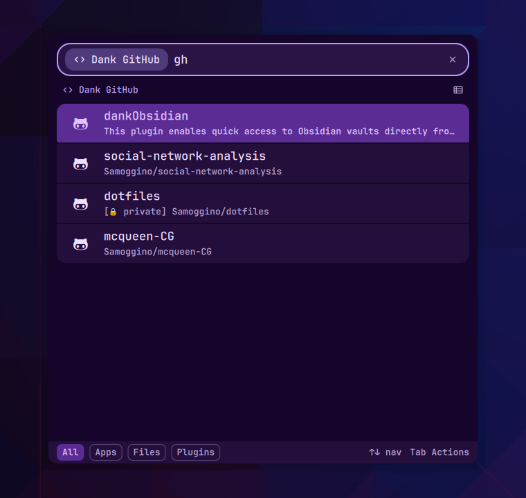
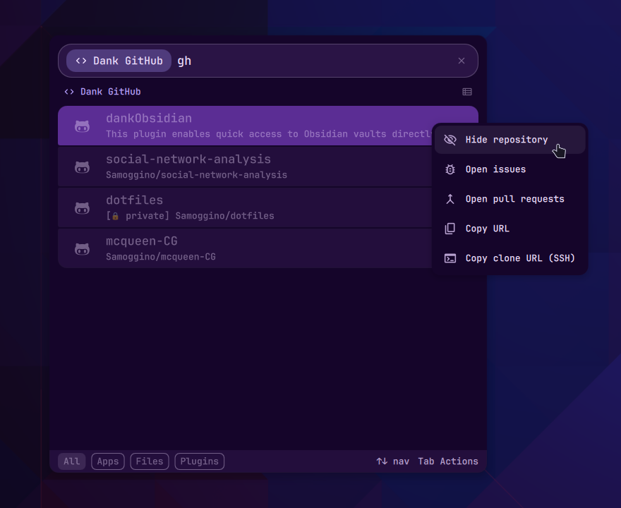

# GitHub Launcher for DuxShell (formerly DankMaterialShell)

A launcher plugin for [DuxShell](https://duxlabs.dev/) (formerly [DankMaterialShell](https://github.com/AvengeMedia/DankMaterialShell)) that lists your GitHub repositories, public **and private**, right in the launcher.



## Features

* **All Your Repositories**: Owned, collaborator and organization repositories, including private ones (with a token).
* **Extra Repositories**: Add any public repository from other users or organizations by hand, so the projects you follow are one keystroke away too.
* **Quick Search**: Filter by repository name, owner or description; multiple words narrow the results.
* **Sorted by Activity**: The most recently pushed repositories come first.
* **Hide Repositories**: Hide a repository from the launcher's context menu (right click or menu key → *Hide repository*), or with the per-repository toggles in the settings.
* **Quick Actions**: Open issues or pull requests, copy the URL or the SSH clone URL from the context menu.
* **Works Offline**: The repository list is cached, so the launcher answers instantly; it is refreshed in the background.
* **Secure Token Storage**: The token is stored encrypted in your system keyring, never in plain text (see [Authentication](#authentication)).
* **Forks & Archived**: Choose whether forks and archived repositories are shown.
* **Always Active Mode**: Show repositories directly in the launcher without a trigger.
* **Custom Trigger**: Define your own keyword (default `gh`).

## Usage

### In the launcher

Type the trigger (default `gh`) followed by part of the repository name, then press Enter to open it in your browser, or Shift+Enter to paste its URL into the focused app.
Private repositories are marked with 🔒, forks and archived repositories are tagged in the description, and repositories you added by hand are tagged as *pinned*.

Right click a repository (or press the menu key) to open its context menu:



| Action | What it does |
|---|---|
| **Hide repository** | Removes the repository from the launcher. Bring it back from the settings. |
| **Open issues** | Opens the repository's issues page. |
| **Open pull requests** | Opens the repository's pull requests page. |
| **Copy URL** | Copies the repository's web URL. |
| **Copy clone URL (SSH)** | Copies the `git@github.com:…` clone URL. |

### In the settings

* **GitHub Username**: used to fetch your public repositories when no token is available.
* **Personal Access Token**: needed for private repositories, see below.
* **Show Forks / Show Archived Repositories**: filter what appears in the launcher.
* **Extra Repositories**: add public repositories that are not yours. Type `owner/name` or paste the repository URL (`https://github.com/owner/name`) and press **Add**. They are always shown, even if they are forks or archived; repositories that cannot be found are reported under the repository list (*Not found: …*).
* **Refresh Interval**: how often the list is re-downloaded (minutes, minimum 5).
* **Repositories**: every repository found, with a **toggle** to show or hide it in the launcher and a **⟳** button to refresh now.

All changes apply to the launcher immediately.

## Authentication

Without any token the plugin only sees your **public** repositories (it just needs your username). To see **private** repositories it needs a token, which is looked up in this order:

1. **`GH_TOKEN` environment variable**, if set in the shell's environment
2. **System keyring** (recommended)
3. **GitHub CLI** (`gh auth token`)
4. No token: public repositories only

> **Note on `GH_TOKEN`:** if `GH_TOKEN` is set in the environment DuxShell is started with (e.g. exported in your session or by another tool), the plugin uses it **instead of** the token in the keyring. That token may have much broader permissions than the read-only one recommended below, and it will be used for every refresh. If you set `GH_TOKEN` for other tools, make sure that is what you want, or start the shell without it.

### 1. Token in the system keyring (recommended)

Create a **fine-grained personal access token**:

1. Go to **github.com → Settings → Developer settings → Personal access tokens → Fine-grained tokens → Generate new token**.
2. Pick an expiration date.
3. Under **Repository access** choose **All repositories**.
4. Under **Permissions**, **Metadata: Read-only** is all you need (it is selected by default). The plugin can only read names and descriptions, never your code.

Paste the token in the plugin settings and press **✓** (or Enter). The field is cleared right away: the token is handed to `secret-tool` and saved in your keyring through the **Secret Service** API, so it is **stored encrypted on disk** and never written to `plugin_settings.json`. The 🗑 button removes it.

It works with any Secret Service provider:

* **GNOME Keyring**: the default on GNOME and on many tiling setups (Hyprland, niri, Sway…).
* **KWallet**: the default on KDE Plasma (KWallet 5.97+ / KWallet 6 expose the Secret Service API).
* **KeePassXC**: with *Secret Service Integration* enabled in its settings.

You can check that the token is there with:

```bash
secret-tool lookup service dankGithub account token
```

#### Do I have to unlock the keyring at every login?

No, as long as your login manager unlocks it for you, which is the usual setup:

* **GNOME Keyring**: `pam_gnome_keyring.so` must be in the PAM file of your login manager (e.g. `/etc/pam.d/greetd`, `/etc/pam.d/sddm`, `/etc/pam.d/login`):
    ```
    auth       optional     pam_gnome_keyring.so
    session    optional     pam_gnome_keyring.so auto_start
    ```
  The *login* keyring is then unlocked with your login password.
* **KWallet**: the same with `pam_kwallet5.so` (`pam_kwallet_init`), which Plasma sets up by default.

If you log in **without typing your password** (autologin, fingerprint only), the keyring cannot be unlocked automatically and you will get an unlock prompt the first time the plugin refreshes.

### 2. GitHub CLI

If you already use the [GitHub CLI](https://cli.github.com/) and are logged in (`gh auth login`), leave the token field empty: the plugin uses `gh auth token`, and `gh` takes care of storing it securely.

### 3. No keyring, no `gh`

Only your **public** repositories are listed (set your username in the settings). There is intentionally no option to save the token in plain text.

> The token never appears in the process list either: it is passed to `curl` through standard input, not as a command-line argument.

## Installation

1. Make sure **DuxShell** (or DankMaterialShell) is installed and working.
2. The easiest way to install is through the plugin registry.
3. Alternatively, clone this repository into your plugins folder:
    ```bash
    cd ~/.config/dms/plugins/
    git clone https://github.com/Samoggino/dankGithub
    ```
4. Enable the plugin, set your username and (optionally) a token in its settings.

## Requirements

* **DuxShell / DankMaterialShell** with launcher plugin support.
* `bash`, `curl` and `xdg-open`.
* For private repositories: `secret-tool` (package `libsecret`) with a Secret Service provider (GNOME Keyring, KWallet, KeePassXC), **or** a logged-in `gh`.

## How I Developed It

Like [Dank Obsidian](https://github.com/Samoggino/dankObsidian), this plugin was developed with **Claude Code**, reusing the same structure (live settings, hidden items, launcher context menu).
It has been tested on CachyOS with Hyprland and GNOME Keyring, but it should work on any Linux distribution and any compositor that supports Quickshell.

## Changelog

### 1.0.1

* Copy actions use the built-in `dms cl copy` (no more `wl-clipboard` dependency) and show a confirmation toast.
* Shift+Enter pastes the repository URL into the focused app.

### 1.0.0

* Initial release: public and private repositories in the launcher, extra public repositories added by hand, hide repositories, context menu actions, cached list with background refresh, token stored in the system keyring.

## Credits & License

* Based on the structure of [Dank Obsidian](https://github.com/Samoggino/dankObsidian).
* This project is licensed under the **MIT License** - see the [LICENSE](LICENSE) file for details.

Developed with ❤️ by Samoggino on CachyOS, I hope this plugin will be useful for DuxShell users.
